# MIPS Embedded System Development Roadmap

From datasheet to production. Each phase ends in a milestone (◆) that must work
before the next phase starts. Colors mark the stage: Foundation, Bring-up,
Runtime, System, Production.

```mermaid
---
config:
  flowchart:
    wrappingWidth: 380
---
flowchart TD
    P0["<b>Phase 0 · Study the Docs</b><br/>• ISA version: MIPS32 r2 vs r6, endianness<br/>• Core manual: CP0, caches, TLB, hazards<br/>• SoC manual: memory map, IRQ controller, clocks<br/>• Errata + vendor BSP as reference"]
    M0{{"◆ Memory map & boot flow understood"}}

    P1["<b>Phase 1 · Toolchain</b><br/>• Cross GCC / Clang (mips-mti-elf, -EL / -EB)<br/>• binutils, newlib / picolibc<br/>• GDB + OpenOCD over EJTAG<br/>• QEMU Malta for pre-silicon testing"]
    M1{{"◆ Correct ELF builds & disassembles"}}

    P2["<b>Phase 2 · Bare-metal Bring-up</b><br/>• start.S at 0xBFC00000 (kseg1, uncached)<br/>• CP0 Status, watchdog off, SRAM stack<br/>• Polled UART 'hello' — first lifeline<br/>• PLL + DDR init, linker script<br/>• crt0: copy .data, zero .bss → main()"]
    M2{{"◆ C runs from DDR and prints"}}

    P3["<b>Phase 3 · Caches & Memory</b><br/>• Read Config1/2: line size, sets, ways<br/>• Index_Store_Tag init → jump to kseg0<br/>• wback / inv / sync ranges for DMA<br/>• sync barriers; TLB refill if MMU used<br/>• Exception handler: Cause / EPC dump"]
    M3{{"◆ Cached execution + crash dump"}}

    P4["<b>Phase 4 · Interrupts, Timer, Locks</b><br/>• Save context, decode Cause, eret<br/>• Legacy / Vectored / EIC (GIC) dispatch<br/>• Count/Compare system tick (IP7)<br/>• LL/SC atomics, spinlocks, irqsave"]
    M4{{"◆ 1 kHz tick + UART RX interrupt"}}

    P5["<b>Phase 5 · Core Libraries</b><br/>• Intrusive lists, ring buffers<br/>• Bitmaps + clz for schedulers<br/>• Memory pools, TLSF heap<br/>• Timer wheel, printf, endian helpers"]
    M5{{"◆ Unit-tested on host PC"}}

    P6["<b>Phase 6 · OS Port</b><br/>• Pick: super-loop / FreeRTOS / Zephyr / Linux<br/>• Context layout: GPRs, hi/lo, EPC, Status<br/>• Tick ISR → scheduler<br/>• Yield via software IRQ (IP0 / IP1)"]
    M6{{"◆ Tasks preempt reliably"}}

    P7["<b>Phase 7 · Drivers & SDK</b><br/>• GPIO, UART, SPI/I²C, DMA, Ethernet/USB<br/>• HAL API above the register layer<br/>• ROM → SPL → U-Boot, OTA / A-B images<br/>• SDK package + CI (QEMU + HIL board)"]
    M7{{"◆ SDK v1.0 released"}}

    P8["<b>Phase 8 · Harden & Optimize</b><br/>• Perf counters, cache / scratchpad tuning<br/>• wait-based idle, clock gating<br/>• Watchdog, stack guards, crash logs<br/>• Secure boot, EJTAG lockdown"]
    M8{{"◆ Production ready"}}

    P0 --> M0 --> P1 --> M1 --> P2 --> M2 --> P3 --> M3 --> P4 --> M4 --> P5 --> M5 --> P6 --> M6 --> P7 --> M7 --> P8 --> M8

    classDef foundation fill:#E6ECF6,stroke:#3B5B92,color:#1B2433,text-align:left
    classDef bringup    fill:#E1F2F1,stroke:#1F7A7A,color:#1B2433,text-align:left
    classDef runtime    fill:#FBEEE2,stroke:#B5651D,color:#1B2433,text-align:left
    classDef system     fill:#EFE8F7,stroke:#6B4C9A,color:#1B2433,text-align:left
    classDef production fill:#E3F3E9,stroke:#2E7D4F,color:#1B2433,text-align:left
    classDef milestone  fill:#FFFFFF,stroke:#5A6475,color:#1B2433,stroke-dasharray:4 3

    class P0,P1 foundation
    class P2,P3 bringup
    class P4,P5 runtime
    class P6,P7 system
    class P8 production
    class M0,M1,M2,M3,M4,M5,M6,M7,M8 milestone
```

## Stages at a glance

| Stage | Phases | Goal |
|---|---|---|
| Foundation | 0–1 | Understand the chip; build and debug code for it |
| Bring-up | 2–3 | Run C code from cached DDR; get readable crash dumps |
| Runtime | 4–5 | Interrupts, timer tick, locking, reusable data structures |
| System | 6–7 | RTOS or Linux port, drivers, bootloader, packaged SDK |
| Production | 8 | Performance, power, reliability, security |
